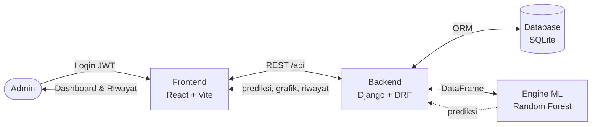
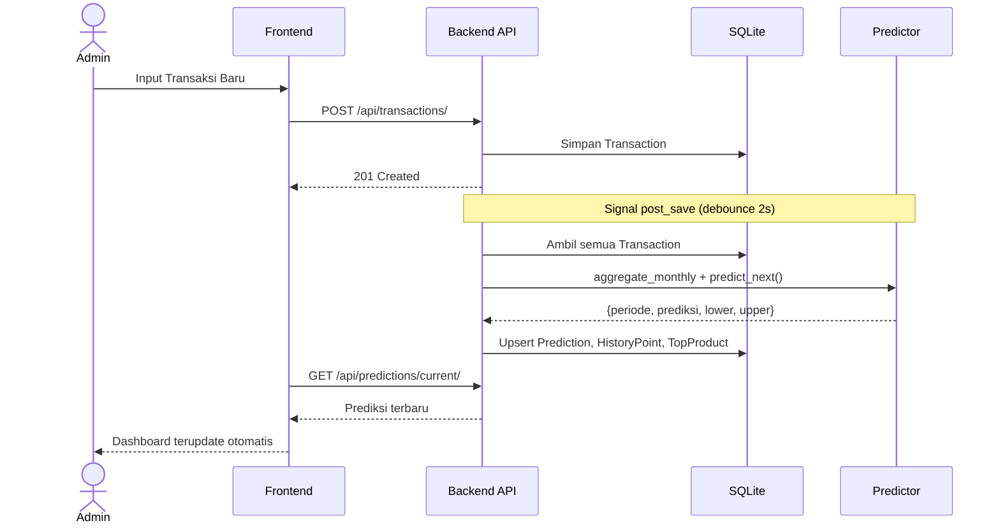

# Analisis Sistem yang Diusulkan — Seruni Predict

> Diagram sederhana, tidak ribet. Copy-paste ke https://mermaid.live untuk export PNG/SVG.

## 1. Context Diagram (Level 0) — Paling Sederhana



**Baca:** Admin hanya interaksi dengan Frontend. Frontend ngobrol ke Backend via API. Backend yang ngatur DB dan minta prediksi ke Engine ML.

---

## 2. Flowchart Sistem Usulan (Alur Utama)

```mermaid
flowchart TD
    A([Mulai]) --> B[Admin Login<br/>POST /api/auth/token/]
    B --> C{Login valid?}
    C -->|Tidak| B
    C -->|Ya| D[Dashboard<br/>GET /api/predictions/current/]

    D --> E[Pilih Menu]
    E --> F[Transaksi<br/>CRUD /api/transactions/]
    E --> G[Customer<br/>CRUD /api/customers/]
    E --> H[Riwayat<br/>GET /api/predictions/history/]

    F --> I{Data berubah?}
    G --> I
    I -->|Ya| J[Auto-Predict<br/>Signal 2 detik<br/>predict_from_db()]
    J --> K[Update Prediksi<br/>Prediction + History + TopProduct]
    K --> D

    H --> L{Aksi}
    L -->|Refresh| M[POST /api/predictions/refresh/]
    L -->|Retrain| N[POST /api/predictions/retrain/]
    L -->|Export| O[GET /api/predictions/export/<br/>CSV]
    M --> K
    N --> K
    O --> H
    H --> P([Selesai])
    D --> P
```

**Kenapa tidak ribet:** Hanya 1 aktor (Admin), 4 menu utama, dan semua perubahan data otomatis memicu prediksi tanpa klik tambahan.

---

## 3. Sequence Sederhana — Auto-Predict (Inti Sistem)



---

### Cara pakai
1. Buka `https://mermaid.live` → paste salah satu blok `mermaid` di atas → Export PNG/SVG.
2. Atau di VS Code install extension `Markdown Preview Mermaid Support` → preview file ini langsung jadi gambar.
3. File ini ada di `docs/analisis-sistem-usulan.md` — tinggal screenshot untuk laporan.
